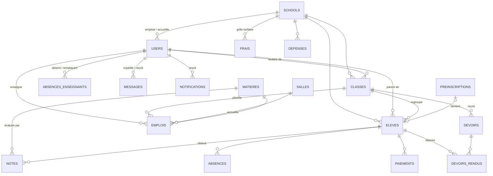

# Modèle de données (PostgreSQL)

Script complet : [`database/schema.sql`](../database/schema.sql).

## Principes

1. **Multi-établissements (SaaS)** : une base unique ; chaque table métier porte `school_id`. Toutes les requêtes de l'API filtrent sur l'établissement de la session, et toute référence (classe, élève, enseignant…) est vérifiée comme appartenant au même établissement.
2. **Historique pluriannuel** : `annee_scolaire` sur les tables métier (classes, élèves, notes, absences, paiements, frais, dépenses, emplois, devoirs, annonces, pré-inscriptions).
3. **Suppression logique** (`deleted`) et **suppression contrôlée** : refus (HTTP 409) si l'élément est référencé, sauf confirmation explicite qui réaffecte/détache d'abord ; certaines suppressions sont impossibles (matière déjà notée).
4. **Immuabilité** : messages envoyés et annonces publiées ne sont ni modifiables ni supprimables.
5. **Traçabilité** : `logs` (anciennes et nouvelles valeurs, consultations), `envois` (messages et e-mails automatiques avec statut).

## Diagramme entité-association

## Tables

| Table | Rôle | Colonnes clés |
|---|---|---|
| `schools` | Établissements clients | `code` unique, `plan`, `status` (trial / active / suspended), `capacite_accueil`, `subscription_end` |
| `users` | Comptes | `role` (superadmin, admin, directeur, enseignant, comptable, parent, eleve), `hash` bcrypt, `heures_max`, `eleve_id` (compte élève), `actif`, `last_login` |
| `classes` | Classes par année | `niveau` CP–CM2, `section`, `cap`, `enseignant_titulaire_id`, `salle_id` |
| `matieres` | Matières | `coef`, `niveau` (ou « Tous »), `enseignant_id` |
| `salles` | Salles | `cap`, `type`, `dispo` |
| `eleves` | Dossiers élèves | état civil, `ville`, `parent_id`, antécédents médicaux, `annee_entree`, `statut` (inscrit / radie / abandon), `date_depart`, `motif_depart`, `consentement_rgpd` |
| `emplois` | Créneaux | `jour`, `debut`, `fin`, classe, matière, enseignant, salle (détection de conflits) |
| `notes` | Évaluations | `eval` (Contrôle continu / Examen), `trimestre`, `note` 0–20 |
| `absences` | Assiduité | `type` (Absence / Retard), `creneau`, `justification_parent`, `statut` |
| `frais` | Grille tarifaire | par année et niveau : `inscription`, `scolarite`, `nb_tranches` |
| `paiements` | Encaissements | `montant`, `mode`, `type`, `recu_num` unique par école |
| `depenses` | Charges | `categorie`, `montant` (prévision budgétaire) |
| `devoirs`, `devoirs_rendus` | Homework | pièces jointes, date de remise, corrigé ; dépôt, statut, note, commentaire, `vu_par_parent` |
| `preinscriptions` | Demandes en ligne | `niveau_demande`, coordonnées du parent, `statut` |
| `annonces` | Annonces immuables | `cible`, `importante`, `corrige_annonce_id` |
| `messages` | Messagerie | `categorie` (dont réclamation, paiement, rappel), `eleve_id`, `brouillon`, `auto`, `lu`, `traite`, `masque_par` |
| `notifications` | Notifications in-app | `lu` |
| `envois` | Journal des envois automatiques | `canal` (messagerie / email), `statut` (envoye / simule / echec) |
| `absences_enseignants` | RH | `nb_heures`, `remplacant_id` |
| `logs` | Journal d'audit | `action`, `entite`, `avant`, `apres` (JSONB) |

Des index composites (`school_id`, `annee_scolaire`, `trimestre`…) accélèrent l'isolation par établissement et les agrégations du module BI.
