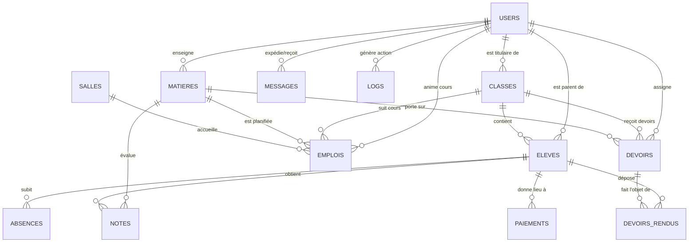

# Spécification Technique & Modèle de la Base de Données
## Application Web de Gestion d'École Primaire (Mono-École)
**Conforme aux Chapitres 1.4, 3, 16, 17 et 18 du Cahier des Charges**

---

## 1. Principes Fondamentaux de Conception

Conformément aux exigences formulées par le Dr Hamdi Hassen dans le Cahier des Charges :
1. **Mono-École (Pas de Multi-Tenancy) :** Une seule base de données dédiée à l'établissement sans champ `ecole_id` superflu.
2. **Historique Pluriannuel (`annee_scolaire`) :** La colonne `annee_scolaire` (ex. `'2026-2027'`) est **obligatoirement présente** sur l'ensemble des tables métier (`classes`, `eleves`, `notes`, `emplois`, `paiements`, `devoirs`, `absences`, `annonces`) pour garantir l'archivage et l'analyse historique d'une année sur l'autre.
3. **Suppression Logique (*Soft Delete*) :** Les enregistrements ne sont pas détruits physiquement mais marqués via `deleted: true` afin de préserver l'intégrité comptable et pédagogique.
4. **Intégrité Référentielle Contrôlée :** La suppression d'une classe contenant des élèves ou d'une matière ayant des notes associées est systématiquement bloquée par l'application (HTTP 409).
5. **Double Compatibilité MongoDB (Mongoose) & PostgreSQL :**
   - Implémentation opérationnelle actuelle en **MongoDB / Mongoose** (Stack MERN).
   - Schéma relationnel standardisé prêt au déploiement en **PostgreSQL** disponible dans [`database/schema.sql`](file:///c:/Users/WE%20TEK/Downloads/ecole-mern/ecole-mern/database/schema.sql) pour hébergement sur Railway, Render, Supabase ou Neon.

---

## 2. Diagramme Entité-Relation (ERD - Modèle Conceptuel)



---

## 3. Dictionnaire Détaillé des Données

### 3.1 Table `users` (Acteurs & Authentification RBAC)
| Champ | Type SQL | Type Mongoose | Contraintes / Description |
| :--- | :--- | :--- | :--- |
| `id` / `_id` | SERIAL PK | ObjectId | Identifiant unique de l'utilisateur |
| `nom` | VARCHAR(150) | String | Nom et prénom de l'utilisateur |
| `email` | VARCHAR(150) | String (Unique) | Adresse e-mail (Login unique, insensible à la casse) |
| `hash` | VARCHAR(255) | String | Empreinte chiffrée du mot de passe (Bcrypt cost 12) |
| `role` | VARCHAR(20) | Enum | `'admin'`, `'enseignant'`, `'comptable'`, `'parent'`, `'eleve'` |
| `telephone` | VARCHAR(30) | String | Numéro de téléphone portable (format international) |
| `eleve_id` | INT / ObjectId | String | Clé étrangère vers l'élève associé (si rôle = `'eleve'`) |
| `enfants` | INT[] | Array [String] | Liste des IDs des enfants rattachés (si rôle = `'parent'`) |
| `created_at` | TIMESTAMP | Date | Date et heure de création |

---

### 3.2 Table `classes` (Divisions Scolaires)
| Champ | Type SQL | Type Mongoose | Contraintes / Description |
| :--- | :--- | :--- | :--- |
| `id` / `_id` | SERIAL PK | ObjectId | Identifiant unique |
| `niveau` | VARCHAR(20) | String | `'CP'`, `'CE1'`, `'CE2'`, `'CM1'`, `'CM2'` |
| `section` | VARCHAR(10) | String | Lettre ou code division (ex: `'A'`, `'B'`) |
| `cap` | INT | Number | Capacité maximale de la classe (ex: 25) |
| `annee_scolaire`| VARCHAR(10) | String | **Année de référence (ex: `'2026-2027'`)** |
| `enseignant_titulaire` | INT FK | ObjectId | Référence vers l'utilisateur titulaire |
| `deleted` | BOOLEAN | Boolean | Indicateur de suppression logique (*soft delete*) |

---

### 3.3 Table `eleves` (Dossier Scolaire & État Civil)
| Champ | Type SQL | Type Mongoose | Contraintes / Description |
| :--- | :--- | :--- | :--- |
| `id` / `_id` | SERIAL PK | ObjectId | Identifiant unique élève |
| `nom` | VARCHAR(100) | String | Nom de famille |
| `prenom` | VARCHAR(100) | String | Prénom |
| `naissance` | DATE | Date | Date de naissance |
| `genre` | CHAR(1) | String | `'M'` (Masculin) ou `'F'` (Féminin) |
| `classe` | INT FK | ObjectId | Référence vers `classes` (Vérification effectif) |
| `parent` | INT FK | ObjectId | Référence vers `users` (Compte parent) |
| `parent_nom` | VARCHAR(150) | String | Nom complet du tuteur légal |
| `parent_email` | VARCHAR(150) | String | E-mail du tuteur (pour relances et notifications) |
| `parent_tel` | VARCHAR(30) | String | Téléphone portable du tuteur |
| `antecedents` | TEXT | String | Antécédents médicaux / allergies |
| `annee_entree` | VARCHAR(10) | String | Année d'admission dans l'école |
| `annee_scolaire`| VARCHAR(10) | String | **Année en cours (ex: `'2026-2027'`)** |
| `statut` | VARCHAR(30) | String | `'inscrit'`, `'pre-inscription'`, `'radie'` |
| `deleted` | BOOLEAN | Boolean | Indicateur de suppression logique |

---

### 3.4 Table `emplois` (Emploi du Temps Hebdomadaire)
| Champ | Type SQL | Type Mongoose | Contraintes / Description |
| :--- | :--- | :--- | :--- |
| `id` / `_id` | SERIAL PK | ObjectId | Identifiant du créneau |
| `classe` | INT FK | ObjectId | Classe concernée |
| `matiere` | INT FK | ObjectId | Matière dispensée |
| `enseignant` | INT FK | ObjectId | Enseignant responsable |
| `salle` | INT FK | ObjectId | Salle de cours affectée |
| `jour` | VARCHAR(15) | String | `'Lundi'`, `'Mardi'`, `'Mercredi'`, `'Jeudi'`, `'Vendredi'`, `'Samedi'` |
| `debut` | TIME | String | Heure de début (ex: `'08:30'`) |
| `fin` | TIME | String | Heure de fin (ex: `'10:00'`) |
| `annee_scolaire`| VARCHAR(10) | String | **Année scolaire de référence** |
| `deleted` | BOOLEAN | Boolean | Soft delete |

*Index d'intégrité :* L'application garantit qu'aucun créneau ne se chevauche pour une même salle, un même enseignant ou une même classe.

---

### 3.5 Table `notes` (Évaluations & Moyennes)
| Champ | Type SQL | Type Mongoose | Contraintes / Description |
| :--- | :--- | :--- | :--- |
| `id` / `_id` | SERIAL PK | ObjectId | Identifiant de la note |
| `eleve` | INT FK | ObjectId | Élève évalué |
| `matiere` | INT FK | ObjectId | Matière concernée |
| `eval` | VARCHAR(50) | String | `'Contrôle continu'`, `'Examen T1'`, `'Examen T2'`, `'Examen T3'` |
| `note` | NUMERIC(4,2) | Number | Note sur 20 (`0 <= note <= 20`) |
| `commentaire` | TEXT | String | Remarque pédagogique facultative |
| `annee_scolaire`| VARCHAR(10) | String | **Année scolaire** |
| `deleted` | BOOLEAN | Boolean | Soft delete |

---

### 3.6 Table `paiements` (Comptabilité Scolaire & Reçus)
| Champ | Type SQL | Type Mongoose | Contraintes / Description |
| :--- | :--- | :--- | :--- |
| `id` / `_id` | SERIAL PK | ObjectId | Identifiant du versement |
| `eleve` | INT FK | ObjectId | Élève bénéficiaire |
| `montant` | NUMERIC(10,2)| Number | Montant en TND (`montant > 0`) |
| `mode` | VARCHAR(30) | String | `'Espèces'`, `'Virement'`, `'Mobile money'` |
| `type` | VARCHAR(50) | String | `'Scolarité T1'`, `'Scolarité T2'`, `'Inscription'`... |
| `recu_num` | VARCHAR(50) | String (Unique) | Numéro officiel (ex: `'REC-2026-000101'`) |
| `date` | DATE | Date | Date du versement |
| `annee_scolaire`| VARCHAR(10) | String | **Année scolaire** |
| `deleted` | BOOLEAN | Boolean | Soft delete |

---

### 3.7 Table `devoirs` & `devoirs_rendus` (Homework)
- **`devoirs` :** `titre`, `desc`, `matiere`, `classe`, `enseignant`, `date_remise`, `bareme`, `corrige`, `annee_scolaire`.
- **`devoirs_rendus` :** `devoir` (FK), `eleve` (FK), `contenu`, `fichier`, `date_depot`, `statut` (`'rendu'`, `'en_retard'`, `'corrige'`), `note`, `commentaire_enseignant`, `vu_par_parent`.

---

### 3.8 Table `absences` (Assiduité & Justifications)
- **Champs :** `eleve` (FK), `date`, `creneau`, `matiere`, `motif`, `justifiee` (Bool), `justification_parent` (Text), `statut` (`'Non justifiée'`, `'En attente de validation'`, `'Justifiée'`, `'Rejetée'`), `annee_scolaire`.

---

### 3.9 Table `messages` & `annonces` (Communication Immuable)
- **`messages` :** `de` (FK), `a` (FK), `objet`, `corps`, `brouillon` (Bool), `auto` (Bool pour notifications auto), `masque` (Array IDs pour masquage sans suppression).
- **`annonces` :** `titre`, `contenu`, `cible` (`'tous'`, `'parents'`, `'enseignants'`, `'eleves'`), `auteur`, `annee_scolaire`. *(Immuabilité stricte garantie).*

---

### 3.10 Table `logs` (Journal d'Audit)
- **Champs :** `user` (ID), `nom` (Nom de l'acteur), `action` (Libellé de l'opération), `data` (JSON avec anciennes et nouvelles valeurs), `createdAt`.

---

## 4. Scripts d'Exécution Disponibles

1. **MongoDB / Mongoose (MERN actif) :**
   - Modèles définis dans [`server/models.js`](file:///c:/Users/WE%20TEK/Downloads/ecole-mern/ecole-mern/server/models.js).
   - Initialisation complète via `cd server && npm run seed`.
2. **PostgreSQL Relational DDL :**
   - Schéma relationnel complet dans [`database/schema.sql`](file:///c:/Users/WE%20TEK/Downloads/ecole-mern/ecole-mern/database/schema.sql).
   - Jeu de données de test dans [`database/seed.sql`](file:///c:/Users/WE%20TEK/Downloads/ecole-mern/ecole-mern/database/seed.sql).
   - Exécution sous PostgreSQL :
     ```bash
     psql -U postgres -d ecole -f database/schema.sql
     psql -U postgres -d ecole -f database/seed.sql
     ```
